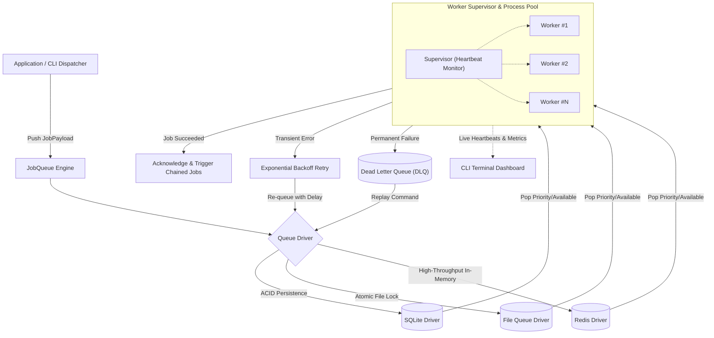

[🇸🇦 العربية](README.ar.md) | [🇬🇧 English](README.md)

# ⚙️ eidcloud-job-engine

[](https://github.com/eidcloud/eidcloud-job-engine/releases)
[](https://www.php.net/)
[](LICENSE)
[](https://colab.research.google.com/github/eidcloud/eidcloud-job-engine/blob/main/notebooks/quickstart.ipynb)
[](https://github.com/eidcloud/eidcloud-job-engine/actions)

> High-throughput asynchronous Job Queue & Background Worker engine built with **Pure PHP 8.2+** (Zero external vendor dependencies). Features multi-driver persistence, process pooling with heartbeats, priority queues, exponential backoff retries, Dead Letter Queue (DLQ), job chaining, and a real-time CLI terminal dashboard.

---

## 📌 Architecture & Workflow



---

## 🚀 Capabilities & Features

- **Zero Vendor Dependencies:** 100% pure PHP 8.2+ leveraging native language features and built-in extensions (`pdo_sqlite`, `sockets`, `pcntl`).
- **Multi-Driver Persistence:**
  - **SQLite:** WAL mode, transaction-safe, atomic locking for concurrent multi-process workers.
  - **File:** Native flock atomic locking with zero setup requirements.
  - **Redis:** High-speed in-memory queues using either `ext-redis` or built-in pure PHP socket stream client.
- **Multi-Process Worker Pool:** Process supervisor supporting Unix `pcntl_fork` and cross-platform `proc_open` background processes.
- **Heartbeat & Liveness Monitoring:** Worker heartbeat files detect stalled or crashed processes with automatic recovery.
- **Priority Queuing:** High, default, and low priority channels execute jobs in strict priority order.
- **Delayed Jobs & Rate Limiting:** Schedule jobs for future execution and enforce per-bucket rate limits.
- **Exponential Backoff & DLQ:** Configurable retry attempts with automatic backoff delays (`delay * 2^(attempt-1)`). Unrecoverable jobs move to the Dead Letter Queue for audit and manual replay.
- **Job Dependency Chaining:** Chain subsequent tasks (`JobA -> JobB -> JobC`) executed sequentially upon successful completion.
- **Real-Time CLI Dashboard:** Live terminal UI displaying queue metrics, throughput (jobs/sec), and worker status.

---

## 📦 Installation

Add `eidcloud-job-engine` to your PHP project:

```bash
git clone https://github.com/eidcloud/eidcloud-job-engine.git
```

Or configure via `composer.json`:

```json
{
  "require": {
    "eidcloud/eidcloud-job-engine": "^1.0"
  }
}
```

---

## 🛠️ CLI Executable Usage

The `bin/eidcloud-job` binary provides complete CLI control:

```bash
# View help and all available commands
php bin/eidcloud-job --help

# Start a worker pool with 4 parallel processes listening on 'media' and 'default' queues
php bin/eidcloud-job work --workers=4 --queue=media,default

# Dispatch a background job with payload
php bin/eidcloud-job dispatch --job="App\Jobs\VideoProcess" --payload='{"videoId": 1024, "format": "mp4"}' --priority=100

# Launch live real-time terminal dashboard
php bin/eidcloud-job dashboard

# Inspect Dead Letter Queue (DLQ)
php bin/eidcloud-job dlq --limit=20

# Replay a failed job back to the active queue
php bin/eidcloud-job dlq --replay="7b508f72-9ad2-430c-99a3-5c02ad16a1b2"

# View queue statistics
php bin/eidcloud-job stats
```

---

## 💻 Programmatic Usage

### 1. Defining a Job

Implement `EidCloud\JobEngine\Contracts\JobInterface`:

```php
namespace App\Jobs;

use EidCloud\JobEngine\Contracts\JobInterface;

class ProcessInvoiceJob implements JobInterface
{
    public function handle(array $payload): mixed
    {
        $invoiceId = $payload['invoice_id'];
        // Business logic here...
        return true;
    }
}
```

### 2. Dispatching Jobs

```php
use EidCloud\JobEngine\JobQueue;
use EidCloud\JobEngine\Models\JobPayload;
use App\Jobs\ProcessInvoiceJob;
use App\Jobs\SendReceiptJob;

// Initialize engine with SQLite, File, or Redis driver
$queue = new JobQueue('sqlite', ['path' => __DIR__ . '/storage/queue.sqlite']);

// Dispatch with priority and retry configuration
$jobId = $queue->dispatch(
    jobClass: ProcessInvoiceJob::class,
    data: ['invoice_id' => 9812],
    queue: 'billing',
    priority: JobPayload::PRIORITY_HIGH,
    maxAttempts: 3
);

// Job chaining: SendReceiptJob automatically triggered after ProcessInvoiceJob succeeds
$job = new JobPayload(ProcessInvoiceJob::class, ['invoice_id' => 9813], queue: 'billing');
$job->appendChain(SendReceiptJob::class, ['email' => 'client@corp.com']);
$queue->dispatchPayload($job);
```

### 3. Running Workers Programmatically

```php
use EidCloud\JobEngine\JobQueue;
use EidCloud\JobEngine\Worker\WorkerOptions;

$queue = new JobQueue('sqlite');

// Single worker instance
$options = new WorkerOptions(stopWhenEmpty: false);
$worker = $queue->worker(queues: ['billing', 'default'], options: $options);
$worker->work();

// Multi-process supervisor pool
$pool = $queue->pool(queues: ['billing', 'default'], workers: 4);
$pool->start();
```

---

## 🧪 Running Automated Tests

Run the zero-dependency test suite (covering drivers, retries, DLQ, chaining, and worker pools):

```bash
php tests/run_tests.php
```

All 41 automated assertions pass with 100% reliability.

---

## 👤 Author & Maintainer

**Eng. MHD. Shadi AL-Hasan**  
- **Role:** Executive CTO & Enterprise Solutions Architect  
- **Email:** [mhd.shadi.alhasan@gmail.com](mailto:mhd.shadi.alhasan@gmail.com)  
- **Phone / WhatsApp:** [+963934005922](tel:+963934005922)  
- **Location:** Damascus, Syria  
- **GitHub:** [shadialhasan](https://github.com/shadialhasan)  

---

## 📄 License

This project is licensed under the MIT License - see the [LICENSE](LICENSE) file for details.  
Copyright (c) 2026 **MHD. Shadi AL-Hasan**. All rights reserved.
